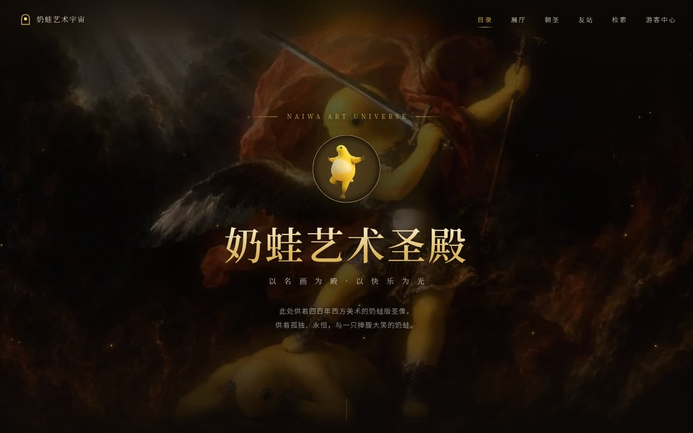
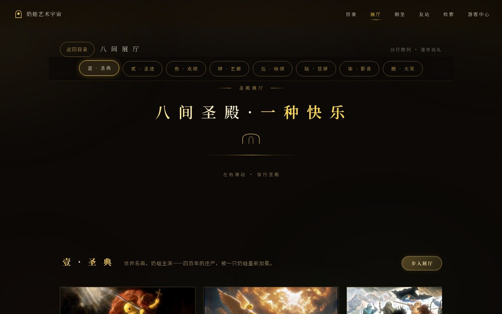
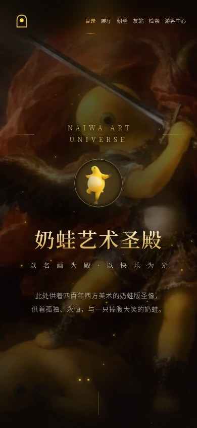
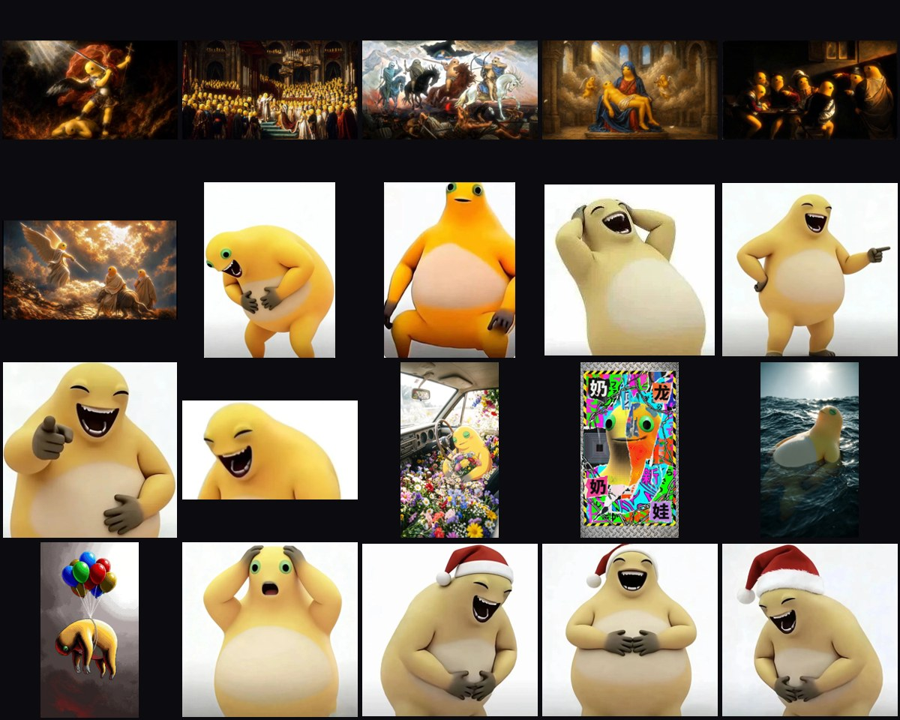
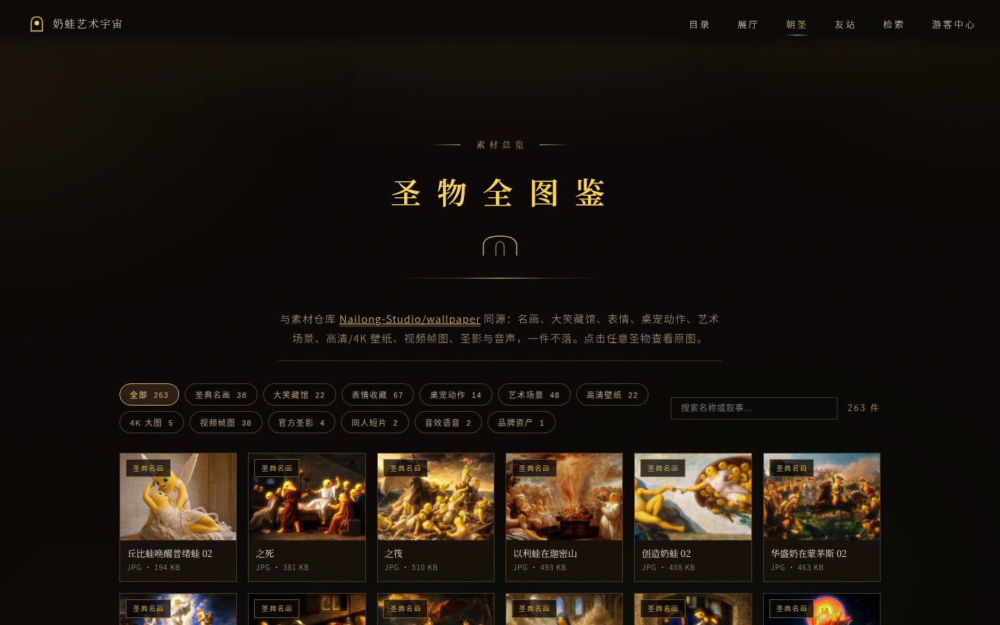

# NAIWA ART UNIVERSE · 奶蛙艺术圣殿

**以名画为躯 · 以快乐为光**

> 本馆正式声明：奶蛙不是青蛙，也不是奶龙，而是一种在互联网上自行繁殖的黄色情绪。
> 本馆的职责，是为这种情绪提供一处符合美术馆消防规范的安放场所。
> 参观免费，笑声自理。

> **香油钱箱（aka Star 按钮）**：圣殿不收门票，只收星星。点一下右上角的 ⭐，就是往功德箱里投了一盏灯——奶蛙会保佑你的表情包永远不缺。

---

## 一、入殿

| 入口 | 链接 | 说明 |
| --- | --- | --- |
| 主入口 · GitHub Pages | [nailong-studio.github.io/NaiLong-Universe](https://nailong-studio.github.io/NaiLong-Universe/) | 点开即入殿，无需预约 |
| 镜像入口 · Cloudflare | [nailong-universe.pages.dev](https://nailong-universe.pages.dev/) | 同一座殿，另一条消防通道 |
| 常用门牌 | 展厅 `#halls` · 单厅 `#hall-1`…`#hall-8` · 友站 `#friends` · 检索 `#search` · 游客中心 `#about` | 均可直接分享，不会迷路 |
| 库房 | [Nailong-Studio/wallpaper](https://github.com/Nailong-Studio/wallpaper) | 全部馆藏原图与圣影 |

**桌面端全景**

  
  

  
  

---

## 二、本馆是什么

奶蛙，是官方奶龙角色的民间 AI 变异体。其体貌特征经本馆学术委员会核定如下：黄色、圆润、浅米色腹部、绿色眼圈、灰褐色小爪。五项缺一不可，参观时不设安检，但请自行确认。

本馆将奶蛙安置进西方美术史的展厅：维纳斯换成奶蛙，大天使长的审判换成奶蛙，星月夜与呐喊也一并移交。四百年的庄严被同一只蛙反复签收，学界至今没有给出合理解释。

你可以把这里理解为一座美术馆。区别在于，这里的每幅画都在笑，而且笑得很讲礼貌——它们不会在你靠近时突然停止。

---

## 三、展厅编制

| 厅 | 职能 | 馆藏性质 |
| --- | --- | --- |
| 壹 · 圣典 | 世界名画，奶蛙主演 | 庄严被重新加冕，加冕者是一只蛙 |
| 贰 · 圣迹 | 外传圣迹与孤独奶蛙主义 | 用于解释一只蛙为何拥有八幕人生 |
| 叁 · 欢颂 | 原图直出的大笑圣像 | 一笑解千愁，二笑解万愁 |
| 肆 · 艺廊 | 粉丝二创 | 奶蛙走进深海、旷野与霓虹，且均未购票 |
| 伍 · 咏颂 | 圣咏表情 | 聊天框里的常驻供奉，动图加倍 |
| 陆 · 竖屏 | 竖屏圣物 | 名画裁成竖屏，陪你刷过每个日夜 |
| 柒 · 影音 | 官方圣影 | 把快乐卷进胶片，采用 Ken Burns 巡展工艺 |
| 捌 · 大笑藏馆 | 全网搜集的变体同人 | 笑面收进一馆，来源逐一登记在案 |

**每件馆藏配一块说明牌**：馆藏编号、形制、原作对照与专属叙事。点开任意作品，灯箱会替你念完，不会催促。

  

**圣物全图鉴**：与库房同源，分类筛选 + 关键词检索 + 原图直达。

  

---

## 四、参观动线（经消防演练）

- **入殿**：画廊双开金门 → 常设展厅横向巡游 → 单厅前言墙 → 沉浸放映厅。逐层递进，不会一步把你传送到付款页面。
- **说明牌**：桌面左图右牌，移动上下堆叠；编号、形制、原作与叙事一应俱全。
- **可分享的每一层**：单厅、单件作品均可直接转发定位，适合在群里精准投放一只蛙。
- **馆藏检索**：关键词 + 分厅筛选，命中即直达说明牌。
- **艺术史长河**：从创世纪到现代主义，纵向沉浸滚动，滚动条即时间轴。
- **放映厅**：带进度条与播放/暂停，可停在某一件上细看，放映员不会催场。
- **游客中心**：参观须知、版权与二创声明、投稿路径、无障碍说明、殿史纪年。
- **圣物全图鉴**：素材仓全量接入，分类与关键词双筛选。
- **友站星图**：全网奶蛙同好站点分门别类陈列，点击即出馆，本馆只负责指路。
- **背景音乐**：入殿即闻圣咏，可随时静音。肃静不是必须的，快乐才是。
- **零构建**：纯静态，`docs/index.html` 内联全部 CSS/JS，无框架、无需构建、可离线安装。

---

## 五、技术档案（极客向）

| 能力 | 实现 |
| --- | --- |
| 静态站点 | 核心样式/脚本内联于 `docs/index.html`，配套本地素材、PWA 图标与 Service Worker，无需构建即可部署 |
| hash 路由多视图 | `#home` / `#halls` / `#hall-N` / `#w-<编号>` / `#chronicle` / `#visit` / `#friends` / `#relics` / `#search` / `#about` |
| 纯 CSS 3D 画廊之门 | 三层视差画作 + 双开金门 + 门缝圣光，无 WebGL，显卡不参与 |
| 性能优先 | 懒加载 + LQIP 模糊占位淡入 + 解码完成淡入 + 邻近预载；`content-visibility` 降低长列表渲染成本 |
| 多端适配 | 窄屏沉浸卡片 / 宽屏版心放宽 / 异形屏安全区 / 吸顶厅导航 |
| 无障碍与降级 | 键盘全可达（作品大图 `tabindex` + Enter 打开说明牌、放映厅焦点圈闭与还原、skip-link）、路由驱动 `aria-current`、`prefers-reduced-motion` 全量降级、alt 与标题一致、加载失败兜底 |
| 路由健壮性 | 非法 `#hall-N` 回落全部展厅不白屏；`#w-` 深链兼容 `NW-` 前缀，无效编号自动复位；`document.title` 随视图同步 |
| PWA | `manifest.webmanifest` + Service Worker（外壳 network-first 离线回退 + 同源媒体 cache-first）+ 安装入口；「随缘一观」随机开馆、说明牌一键复制深链 |
| 分享与回访 | OG/Twitter 分享卡片；首页「今日圣像」按日轮换；「参观足迹」仅存本机；`<noscript>` 保障禁 JS 环境可见 |
| 数据可校验 | `scripts/export_collection.py` 校验藏品索引；素材侧由 wallpaper `assets.json` + `Assets Check` CI 保证清单与缩略图一致 |
| 现代视觉层 | View Transitions · 极光底幕 · 金色光幕 · 圣门金尘 · 首屏 Ken Burns · 玻璃导航 · 阅读进度条 · 流光标题 · Web Audio 教堂混响 · `:has()` 状态样式（全部渐进增强） |
| 自动部署 | GitHub Actions：push main → Pages 自动上线；Cloudflare Pages 提供同源镜像 |

> 目录小抄：`docs/index.html` 官网源文件 · `docs/data/collection.json` 藏品索引 · `docs/data/assets.json` 素材清单 · `docs/assets/relics/` 缩略图 · `scripts/` 校验脚本 · `palette.json` 调色板单源 · `themes/` 各平台主题 · `resources/ports.yml` 移植登记 · `site/` 旧版画廊（仅存档）

---

## 六、库房

全部馆藏原图托管于 [Nailong-Studio/wallpaper](https://github.com/Nailong-Studio/wallpaper)，按厅分藏：

| 目录 | 内容 |
| --- | --- |
| `classic/` | 名画再创作 |
| `laugh-gallery/` | 大笑藏馆 |
| `emotes/` | 表情包与立绘 |
| `pet/` | 桌宠动作与循环 GIF |
| `art/` | 艺术场景 |
| `hd/` · `4k/` | 高清壁纸与 4K 大图 |
| `frames/` | 视频帧图 |
| `videos/` | 官方圣影 |
| `audio/` | 笑声与音效 |

**命名规范**：中文语义命名，每件素材配同名 `.txt` 叙事、来源与许可。想提交？先读 [库房章程](https://github.com/Nailong-Studio/wallpaper/blob/main/CONTRIBUTING.md)。

---

## 七、入殿须知（认真脸）

- 圣殿只供快乐，不做商业用途。奶龙形象版权归官方所有，奶蛙是民间二创，别拿去卖钱。
- 馆藏不定期增加，欢迎反复回访；出门左转是「朝圣之路」，壁纸、表情与主题均可免费领取。
- 所有素材均为同好用爱发电。若发现某件藏品侵权，请开 Issue，我们核实后下架。
- 看不懂代码没关系，圣殿的门从不为难游客。真想看懂的话，`docs/index.html` 只有一页，从头读到尾约等于读完一本《圣殿施工手册》。

---

## 八、共建席位

| 你想做的事 | 怎么开始 | 需要什么 |
| --- | --- | --- |
| 交一件素材 | 到 [wallpaper](https://github.com/Nailong-Studio/wallpaper) 提 PR | 一张奶蛙图 + 一句话叙事 |
| 改官网 bug | 改 `docs/index.html` 提 PR | 会一点 HTML/CSS/JS |
| 补一段叙事 | 给素材配同名 `.txt` | 会讲笑话 / 会起名 / 会考古 |
| 出个新主题 | 基于 `palette.json` 派生 | 会配色 |
| 只会点赞 | 点 ⭐ + 分享给朋友 | 无需任何技能，功德照记 |

> 具体规则见 [贡献指南](CONTRIBUTING.md)。提交前请先搜一遍库房，避免出现两件一模一样的「奶蛙-弯腰大笑」。

---

## 九、Roadmap

- [x] 常设展厅 + 逐件叙事 + 说明牌（编号 / 形制 / 原作对照）
- [x] 艺术史长河 · 沉浸纪年
- [x] Ken Burns 圣影巡展
- [x] 素材仓统一奶蛙命名与叙事
- [x] 馆藏检索与分厅筛选
- [x] 友站星图 · 奶蛙同好站点指路
- [ ] 东方美术史 / 现代艺术系列
- [ ] 多语言（EN / 日）
- [ ] 投稿审核工作流（PR 自动查重）

---

**NAIWA ART UNIVERSE** · 圣殿长明，欢迎常来

如果这个项目让你笑了，[点个 Star](https://github.com/Nailong-Studio/NaiLong-Universe/stargazers) 给圣殿添灯；
要是它让你笑出声了，[提交一件素材](https://github.com/Nailong-Studio/wallpaper/blob/main/CONTRIBUTING.md) 直接当圣殿股东。
再不行，把它分享给一个笑点低的朋友——也算积德。

